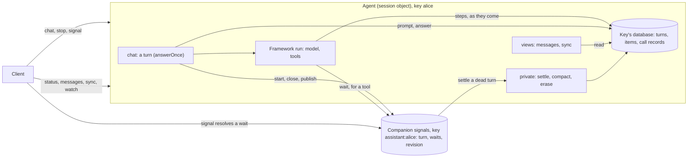

# The conversation of turns: design and plan

`@restatedev/agents` runs an AI agent as a Restate session object: each key
of the agent (a user, a thread) is one conversation, in that key's own SQL
database, answered one message at a time. These pages describe the
conversation model this package is moving to, the one the Python SDK's
`restate.agents` adopted in
[restatedev/sdk-python#296](https://github.com/restatedev/sdk-python/pull/296),
and the plan to get there.

**Status: implemented.** These pages describe the code, after
[the plan](plan.md)'s steps (its Status lists them). Where these pages say "today", they mean v0.3.0, before the port: kept to
explain why the model is as it is. Where the
code differs from the design: OpenCode left the package (the plan's D6, see
[The frameworks](frameworks.md#opencode)); snapshots are not ported (D3);
DeepSeek's harness has no compaction mounted, and a pi provider's outage
still ends its turn (both in [The frameworks](frameworks.md)).

## In brief

- **A conversation is a sequence of turns.** A turn is one prompt and what
  answers it: its steps (the model's replies, tool calls and results) and its
  answer. Turns never overlap, so at most one turn has no answer: the latest.
- **The turn is the unit of storage.** One row per turn (the transcript),
  and every other item tagged with its turn (the trajectories), in one
  sequence of positions that are the message ids clients see. One store, the
  same for every framework, with the same tables as the Python SDK.
- **The core owns the conversation; a framework owns its loop.** A framework
  gives its `Items` (how its messages are stored and read) and a run (its own
  loop, which stores each step as it comes). The core answers each prompt
  once (`answerOnce`), decides what the model gets, closes turns, keeps the
  call records, and renders what clients read.
- **What the model gets is composed in one place,** `history()`: a summary,
  the earlier turns' messages and answers within a budget, and the latest
  turns whole (the turn projection). A framework that cannot be handed a list
  of messages (pi, DeepSeek) keeps its own history, and the turn
  holds copies of its messages (framework-owned history).
- **Every write is the turn's own, made once:** the prompt by its id, a
  tool's Restate calls by idempotency keys. A retried attempt resumes from
  what is stored; it does not replay, and does not ask the model again for a
  reply it stored.
- **A turn whose invocation dies is closed, never finished:** `settle`, or
  the next message, gives each open call a result and ends the turn as
  `ended`. Today every framework finishes such a turn under the next
  invocation instead, which can make a dead turn's Restate calls twice.
- **The companion** (the `signals` object) is the control plane: the turn
  being answered, the tools' waits, and a revision clients follow. Nothing in
  it is needed to complete a turn.

## The pages

| Page                                | What it holds                                                                                                                                           |
| ----------------------------------- | ------------------------------------------------------------------------------------------------------------------------------------------------------- |
| [The plan](plan.md)                 | the decisions, the steps in order (each with its files, design, tests and when it is done), what must hold afterwards, the tests that define it, review |
| [Turn semantics](turns.md)          | what a turn is; its life, its end, attempts, stops, dead turns and `settle`; the turn model in code; what clients see; the guarantees                   |
| [The conversation](conversation.md) | the data layout (every table), a worked example, which turns a turn loads, what the model gets, framework-owned history, the call records, the schemas  |
| [The frameworks](frameworks.md)     | per framework: how it works today (with the problems found), the library's own model, and how it maps onto the store                                    |

To implement it, read [the plan](plan.md) first, then turns, the
conversation and the frameworks. To understand it, read turns, then the
conversation.

## The reference: the Python SDK

The Python SDK implemented this model first, and documented it for this port.
Its pages and code, at the commit that landed it
([`434bb6f`](https://github.com/restatedev/sdk-python/commit/434bb6fe05ab17f3384709b48f060a47e68f5fb7)):

- **Its pages**, [`docs/agents/`](https://github.com/restatedev/sdk-python/tree/434bb6fe05ab17f3384709b48f060a47e68f5fb7/docs/agents): `turns.md`,
  `conversation.md`, `frameworks.md`, `learnings.md`, `porting.md` (written
  for this port), `testing.md`, `steps-retention.md`.
- **The conversation**, `answer_once`, `settle` and `compact`:
  [`_conversation.py`](https://github.com/restatedev/sdk-python/blob/434bb6fe05ab17f3384709b48f060a47e68f5fb7/python/restate/agents/_conversation.py).
- **What clients read**:
  [`_messages.py`](https://github.com/restatedev/sdk-python/blob/434bb6fe05ab17f3384709b48f060a47e68f5fb7/python/restate/agents/_messages.py).
- **The call records**:
  [`_calls.py`](https://github.com/restatedev/sdk-python/blob/434bb6fe05ab17f3384709b48f060a47e68f5fb7/python/restate/agents/_calls.py).
- **The turn's wrapper** and `answering`:
  [`_turn.py`](https://github.com/restatedev/sdk-python/blob/434bb6fe05ab17f3384709b48f060a47e68f5fb7/python/restate/agents/_turn.py).
- **The companion** (`Started.settles`, `ended`):
  [`_signals.py`](https://github.com/restatedev/sdk-python/blob/434bb6fe05ab17f3384709b48f060a47e68f5fb7/python/restate/agents/_signals.py).
- **The object** (`settle`, `compact`, `erase`):
  [`_object.py`](https://github.com/restatedev/sdk-python/blob/434bb6fe05ab17f3384709b48f060a47e68f5fb7/python/restate/agents/_object.py).
- **Constants and errors** (`ENDED`, `RETURNED_UNRECORDED`, `cut_off_result`,
  `WINDOW`, `BUDGET`, `SUMMARIZE`, refusals):
  [`_common.py`](https://github.com/restatedev/sdk-python/blob/434bb6fe05ab17f3384709b48f060a47e68f5fb7/python/restate/agents/_common.py).
- **Tools and `wait_for`**:
  [`_tools.py`](https://github.com/restatedev/sdk-python/blob/434bb6fe05ab17f3384709b48f060a47e68f5fb7/python/restate/agents/_tools.py).
- **Integrations on the turn projection**:
  [`openai/_agent.py`](https://github.com/restatedev/sdk-python/blob/434bb6fe05ab17f3384709b48f060a47e68f5fb7/python/restate/agents/openai/_agent.py),
  [`langgraph/_agent.py`](https://github.com/restatedev/sdk-python/blob/434bb6fe05ab17f3384709b48f060a47e68f5fb7/python/restate/agents/langgraph/_agent.py).
- **Framework-owned history** (a LangGraph graph's own state):
  [`langgraph/_graph.py`](https://github.com/restatedev/sdk-python/blob/434bb6fe05ab17f3384709b48f060a47e68f5fb7/python/restate/agents/langgraph/_graph.py),
  [`langgraph/_checkpointer.py`](https://github.com/restatedev/sdk-python/blob/434bb6fe05ab17f3384709b48f060a47e68f5fb7/python/restate/agents/langgraph/_checkpointer.py).
- **The tests that define it**:
  [`tests/agents_conversation.py`](https://github.com/restatedev/sdk-python/blob/434bb6fe05ab17f3384709b48f060a47e68f5fb7/tests/agents_conversation.py),
  [`agents_messages.py`](https://github.com/restatedev/sdk-python/blob/434bb6fe05ab17f3384709b48f060a47e68f5fb7/tests/agents_messages.py),
  [`agents_signals.py`](https://github.com/restatedev/sdk-python/blob/434bb6fe05ab17f3384709b48f060a47e68f5fb7/tests/agents_signals.py),
  [`agents_tools.py`](https://github.com/restatedev/sdk-python/blob/434bb6fe05ab17f3384709b48f060a47e68f5fb7/tests/agents_tools.py),
  [`agents_snapshots.py`](https://github.com/restatedev/sdk-python/blob/434bb6fe05ab17f3384709b48f060a47e68f5fb7/tests/agents_snapshots.py) (its `wait_for`
  and approval tests).
- **Past bugs, brought back**:
  [`scripts/resurrect.py`](https://github.com/restatedev/sdk-python/blob/434bb6fe05ab17f3384709b48f060a47e68f5fb7/scripts/resurrect.py).

Port the behaviour, not the Python idioms: an asyncio lock is a promise
chain here, `Stop.guard` is a race with the turn's `AbortSignal`
(`stopSignalOf`), and per-attempt state is a `ScopeKey`, as it is today.

### Where this package differs on purpose

- **Framework-owned history** is a way of its own here. Three of this
  package's frameworks (pi, DeepSeek) are durable engines with their
  own stores, which cannot be handed a list of messages: each keeps its
  history, and its turns hold copies of its messages
  ([The conversation](conversation.md#framework-owned-history)). The Python
  SDK has this only for a LangGraph graph of your own (`graph=`).
- **Snapshots are not ported** (no framework here needs them). Their table is
  created anyway, so that the schema is the Python SDK's, step for step.
- **Names** follow this package: `answerOnce`, `askAgain`, `stopSignalOf`,
  the `signal` tool (Python's `wait_for_signal`), `waitFor`.
