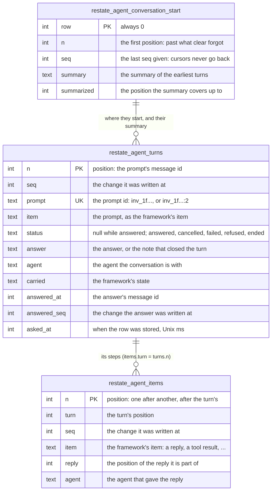
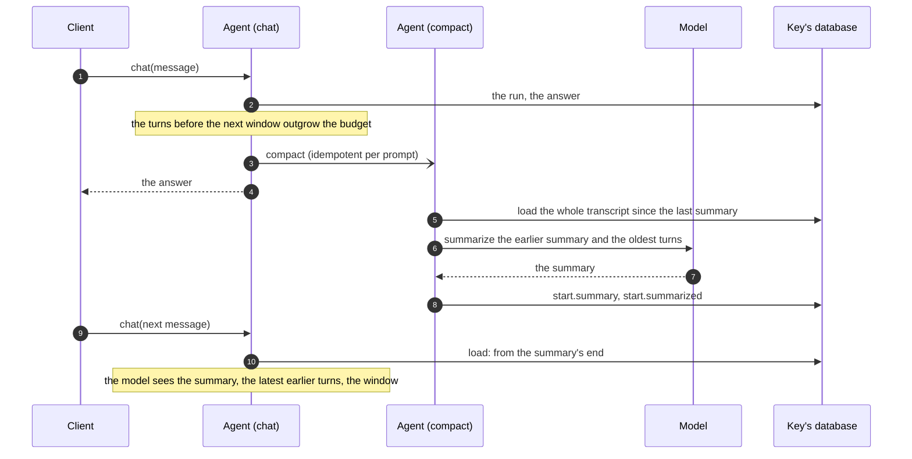

# The conversation

What an agent's conversation is made of, how it is stored, which part of it a
turn reads, and what the model gets. The turn itself (its life, its end,
attempts, stops, dead turns) is in [Turn semantics](turns.md).

**Status: implemented** ([the plan](plan.md)). Where these pages say "today", they mean v0.3.0, before the port: kept to
explain why the model is as it is. In v0.3.0 each
framework kept its own conversation, in its own tables, and
`restate_agent_log` was a copy of it that clients read. All of that is
replaced by the store below, the same for every framework, and the same
as the Python SDK's
([its `conversation.md`](https://github.com/restatedev/sdk-python/blob/434bb6fe05ab17f3384709b48f060a47e68f5fb7/docs/agents/conversation.md)).

The code: [`src/conversation.ts`](../src/conversation.ts) (the tables, `Conversation`,
`Turn`, `answerOnce`, `settle`, `compact`), [`src/messages.ts`](../src/messages.ts) (the
`messages` view) and [`src/calls.ts`](../src/calls.ts) (the call records).

## Conversation and turns

- **A conversation is a key's database.** Each key of an agent (`alice` of
  `assistant`) has its own SQL database, and its conversation is the tables
  below in it. Nothing in it is shared with another key.
- **A conversation is a sequence of turns,** in the order their messages
  came. A turn is one prompt and what answers it:
  - its **row**: the prompt, then, once the turn ends, its status, its answer
    and what it carries to later turns. The rows together are the
    _transcript_;
  - its **steps**: everything else it stored, the model's replies, the tool
    calls and their results, a message that asked again. A turn's steps are
    its _trajectory_.
- **Turns never overlap**, so at most one turn has no answer: the latest
  ([One message at a time](turns.md#one-message-at-a-time)).
- **Every row belongs to one turn,** and only the latest turn, while it has
  no answer, is written ([The turn model](turns.md#the-turn-model)).
- **The model's input is composed from the turns in one place,**
  `Conversation.history()`: the [turn projection](#what-the-model-sees). A
  framework that keeps its own history gives the model that instead
  ([Framework-owned history](#framework-owned-history)).
- **Clients read the turns as stored**, in two projections of the same rows:
  the full view (every step) and the summary view (each turn's message and
  answer), under the same message ids.



## The tables

Schema `restate_agents.turns`, in every key's database. Its steps are the
Python SDK's, in the same order, so that a database's record of its schemas
is the same in both SDKs (`Schema` counts steps by name:
[`packages/sessions/src/schema.ts`](../../sessions/src/schema.ts)):

```ts
const SCHEMA = new Schema('restate_agents.turns', [
  `CREATE TABLE restate_agent_turns (
    n INTEGER PRIMARY KEY,
    seq INTEGER NOT NULL,
    prompt TEXT NOT NULL UNIQUE,
    item TEXT NOT NULL,
    status TEXT,
    answer TEXT,
    agent TEXT,
    carried TEXT,
    answered_at INTEGER,
    answered_seq INTEGER,
    asked_at INTEGER
  )`,
  'CREATE INDEX restate_agent_turns_seq ON restate_agent_turns (seq)',
  'CREATE INDEX restate_agent_turns_answered_seq ON restate_agent_turns (answered_seq)',
  `CREATE TABLE restate_agent_items (
    n INTEGER PRIMARY KEY,
    turn INTEGER NOT NULL,
    seq INTEGER NOT NULL,
    item TEXT NOT NULL,
    reply INTEGER,
    agent TEXT
  )`,
  'CREATE INDEX restate_agent_items_seq ON restate_agent_items (seq)',
  `CREATE TABLE restate_agent_conversation_start (
    row INTEGER PRIMARY KEY CHECK (row = 0),
    n INTEGER NOT NULL,
    seq INTEGER NOT NULL,
    summary TEXT,
    summarized INTEGER
  )`,
  // Snapshots are not ported (see plan.md, D3): the table is made, unused,
  // so that the schema's steps stay the Python SDK's.
  `CREATE TABLE restate_agent_snapshots (
    id INTEGER PRIMARY KEY,
    covers INTEGER NOT NULL,
    turn INTEGER,
    items TEXT NOT NULL
  )`,
]);
```

- **Positions.** The two tables share one sequence of positions (`n`), the
  ids of the messages that `messages` shows. A turn's prompt has the turn's
  position; its items come after it, before the next turn's. Turns and
  items are each one range of the primary key, so a turn's steps are one
  range read, and dropping a reply is one range delete.
- **`seq`** increases with every row written, so that a client can ask what
  changed since a cursor. A turn's answer takes one too (`answered_seq`),
  for the summary view; its message's id is `answered_at`, the turn's last
  message of the assistant, the id the full view shows it under.
- **Appends only.** Rows are appended, in one transaction per step (one
  statement commits on its own). A reply at the end can be dropped (to ask
  the model again), which is one range delete; its `seq` is kept in the
  start row, so cursors never go back.
- **Each item is the framework's own** (a message, an event), stored and
  loaded by the framework (`Items.dump`, `Items.load`). The core reads it
  only through `Items.read`: what was said, the tool calls, the results.
  So an agent's conversation is one framework's: `answerOnce` refuses
  items other than its `messages` view's (D7).
- **`reply`** groups the items of one model reply (a reply that is several
  items, say), so that the full view shows it as one message, and `drop`
  removes it whole.
- **The start row** is there only once `clear`, a summary or a dropped
  reply wrote it. With none, the conversation starts at position 0, with no
  summary.
- **`asked_at`** is when the turn's row was stored, in Unix milliseconds.
- **`agent` and `carried`** are what a turn carries
  ([What a turn carries](#what-a-turn-carries)): no framework of this
  package fills them yet.

### Around the conversation

| Where                                                                                                                               | What                                                                                                                                                                                                                            | Written by                                                                                                  |
| ----------------------------------------------------------------------------------------------------------------------------------- | ------------------------------------------------------------------------------------------------------------------------------------------------------------------------------------------------------------------------------- | ----------------------------------------------------------------------------------------------------------- |
| `restate_agent_calls` (schema `restate-agents.calls`, as today), in the key's database                                              | one row: the invocation's Restate calls made by tools, as JSON ([Tool calls, once](#tool-calls-once-the-call-records))                                                                                                          | the tools built on Restate (`call`, `send`, `workflow`, `subagent`, `signal`) and `waitFor`                 |
| the companion's state: the `signals` object, keyed `<agent>:<key>`                                                                  | `turn`: the turn being answered (`Started`: its invocation, since when, whether the agent `settles`); `waiting`: the tools' waits, each with its awakeable; `kept`: signals that came before their wait; `revision`; `watching` | the companion's handlers (`start`, `close`, `ended`, `listen`, `resolve`, `forget`, `publish`, `subscribe`) |
| `restate_langgraph_checkpoints`, `restate_langgraph_channel_values`, `restate_langgraph_writes` (schema `restate-agents.langgraph`) | a LangGraph graph's checkpoints, channel values by version, and pending writes, per thread and namespace                                                                                                                        | `SqlCheckpointSaver`, for a graph of your own; the built-in agent uses none                                 |
| pi-durable's `restate_pi_*` tables (its own migrations, `restate_pi_durable_schema`)                                                | pi's conversation, tasks and documents ([The frameworks](frameworks.md#pi))                                                                                                                                                     | pi, through [`src/pi/storage.ts`](../src/pi/storage.ts)                                                     |
| `restate_deepseek_sessions`, `restate_deepseek_events` (schema `restate-agents.deepseek`)                                           | the DeepSeek Harness's event log ([The frameworks](frameworks.md#deepseek-harness))                                                                                                                                             | the harness, through [`src/deepseek/persistence.ts`](../src/deepseek/persistence.ts)                        |

`clear` empties the key's database (every table above),
the companion's waits and kept signals, and keeps where the ids and cursors
got to.

Gone with the store: `restate_agent_log` and `restate_agent_log_start`
(schema `restate-agents.log`), and Claude's `restate_claude_messages` and
`restate_claude_answers` (schema `restate-agents.claude`). LangGraph's
built-in agent stops using its checkpointer.

## A worked example

Four messages to one key, with `window: 1`, on the made-up framework of the
tests (its items are plain objects). The rows below are what the code
stores; the invocation ids are shortened to `inv_A` to `inv_D`.

1. **A, answered with a tool call.** "What's the weather in Lisbon?": the
   model calls `weather`, gets the result, and answers.
2. **B, asked again.** "Reply in JSON": the first reply is prose, so the
   turn's check asks again within the turn, and the second reply is the
   answer.
3. **C, killed.** "Book a table for 8pm": the model calls `book`, and the
   invocation dies before the call returns. Nothing runs it again.
4. **D, answered.** "Hello?": before its prompt, D finds C without an
   answer, and closes it.

`restate_agent_turns`:

| n   | seq | prompt  | item                                | status   | answer                                                          | answered_at | answered_seq |
| --- | --- | ------- | ----------------------------------- | -------- | --------------------------------------------------------------- | ----------- | ------------ |
| 0   | 1   | `inv_A` | user: What's the weather in Lisbon? | answered | Sunny and 24°C in Lisbon.                                       | 3           | 5            |
| 4   | 6   | `inv_B` | user: Reply in JSON                 | answered | `{"weather": "sunny"}`                                          | 7           | 10           |
| 8   | 11  | `inv_C` | user: Book a table for 8pm          | ended    | Ended: the turn ended before it finished, and was not answered. | 11          | 15           |
| 12  | 16  | `inv_D` | user: Hello?                        | answered | Hello! The table wasn't booked: shall I try again?              | 13          | 18           |

`restate_agent_items`:

| n   | turn | seq | item                                                          | reply | Who wrote it                    |
| --- | ---- | --- | ------------------------------------------------------------- | ----- | ------------------------------- |
| 1   | 0    | 2   | assistant: call `c1` `weather(city="Lisbon")`                 | 1     | A's run                         |
| 2   | 0    | 3   | result `c1`: sunny, 24°C                                      |       | A's run                         |
| 3   | 0    | 4   | assistant: Sunny and 24°C in Lisbon.                          | 3     | A's run                         |
| 5   | 4    | 7   | assistant: Sure: sunny.                                       | 5     | B's run                         |
| 6   | 4    | 8   | user: Reply again, with JSON only.                            |       | B's check (`askAgain`)          |
| 7   | 4    | 9   | assistant: `{"weather": "sunny"}`                             | 7     | B's run, again                  |
| 9   | 8    | 12  | assistant: call `c2` `book(place="Taberna", at="20:00")`      | 9     | C's run                         |
| 10  | 8    | 13  | result `c2`: Ended: …                                         |       | D, closing C                    |
| 11  | 8    | 14  | assistant: Ended: …                                           |       | D, closing C                    |
| 13  | 12   | 17  | assistant: Hello! The table wasn't booked: shall I try again? | 13    | D's answer, stored as its reply |

What to notice:

- **Positions interleave.** A's row is 0 and its steps 1 to 3; B's row is 4.
  Each turn's rows and steps are one range of positions.
- **`seq` follows writes, not positions.** C's closing rows (10, 11) were
  written by D's invocation, before D's own row (seq 16). The answer of each
  turn takes a `seq` of its own (`answered_seq`), after its steps.
- **Every turn ends with an assistant message**, whose position is
  `answered_at`: A's last reply (3), B's reply to the ask (7), C's closing
  note (11), and D's answer, which its run returned without a reply, so the
  turn stored it as one (13).
- **A dead turn is closed, not finished.** C's open call `c2` got a result
  (the note: its Restate call never returned), then the note is C's last
  reply and its answer, with status `ended`.
- **Asking again is a step, not a turn.** B's "Reply again" is an item of B,
  a message of the user.

The `messages` view, `view: "summary"`: each turn's message and answer,
under the full view's ids.

| id  | role      | text                                               |
| --- | --------- | -------------------------------------------------- |
| 0   | user      | What's the weather in Lisbon?                      |
| 3   | assistant | Sunny and 24°C in Lisbon.                          |
| 4   | user      | Reply in JSON                                      |
| 7   | assistant | `{"weather": "sunny"}`                             |
| 8   | user      | Book a table for 8pm                               |
| 11  | assistant | Ended: …                                           |
| 12  | user      | Hello?                                             |
| 13  | assistant | Hello! The table wasn't booked: shall I try again? |

`view: "full"` (the default) shows every step: id 1 is the tool call `c1`
with its output (the result at position 2 is folded into its call, so 2 is
no message of its own), then 3; B's 5, 6 and 7; C's 9 (`c2`, with the closing
note as its output) and 11; D's 12 and 13.

What D's model got (`history()`, with `window: 1`):

| Item                                 | From                                             |
| ------------------------------------ | ------------------------------------------------ |
| user: What's the weather in Lisbon?  | A, before the window: its prompt…                |
| assistant: Sunny and 24°C in Lisbon. | …and its answer, without its tool call           |
| user: Reply in JSON                  | B, the latest turn its framework answered: whole |
| assistant: Sure: sunny.              |                                                  |
| user: Reply again, with JSON only.   |                                                  |
| assistant: `{"weather": "sunny"}`    |                                                  |
| user: Book a table for 8pm           | C, ended: whole, whatever the window             |
| assistant: call `c2` `book(...)`     |                                                  |
| result `c2`: Ended: …                |                                                  |
| assistant: Ended: …                  |                                                  |
| user: Hello?                         | D, the turn being answered                       |

The window is, from the latest turn back, every turn its framework didn't
answer (D, being answered, and C, ended), then the latest `window` turns it
answered (B). A is before the window: the model sees its prompt and answer
only, within the budget.

## Which turns a turn loads

A turn reads what it needs, not the whole conversation:

1. The start row, and the last position and `seq` given.
2. The transcript, from the latest turn back, 64 turns at a time, until it
   holds the window and the earlier turns that the budget holds (the model
   sees no more of them), or the summary's end.
3. The trajectories of the window's turns: one range read, from the first
   window turn's position on.

The **window** is, from the latest turn back:

- every turn its framework did not answer: the one being answered (only the
  latest can be one), and any that another invocation ended (`Ended: …`).
  Their framework never finished them, so what they carried is a guess, and
  the next turn reads what happened from their rows;
- then the latest `window` turns their framework answered.

Once the window holds its `window` answered turns, the walk stops: an ended
turn before them is not in it.

| Turns, oldest first             | `window` | Loaded whole                                           |
| ------------------------------- | -------- | ------------------------------------------------------ |
| a, b, _being answered_          | 1        | b, _being answered_                                    |
| a, b, _being answered_          | 0        | _being answered_                                       |
| a, _ended_, _being answered_    | 0        | _ended_, _being answered_                              |
| a, _ended_, c, _being answered_ | 1        | c, _being answered_ (c carried on from the ended turn) |

`window` is an agent option (default 1: the previous turn's tool calls stay
in view, for a follow-up), or `'all'`. A retried attempt of an answered turn
reads only its answer, by the prompt's unique id.

## What the model sees

`Conversation.history()`, in order:

1. The summary of the earliest turns, if they have one: by default a user's
   message with it (`SUMMARY` and the text) and the assistant's
   acknowledgement ("Understood."); or the framework's own form
   (`Items.summary`).
2. The turns before the window, as their prompt and answer: the latest of
   them that the agent's `budget` holds (32 000 tokens by default, counted
   as 4 characters each). Each is the turn's prompt item, then
   `Items.reply(answer, agent)`.
3. The window's turns, whole.

The model sees the earlier turns' messages, not their tool calls: those of
the window only. The `messages` view shows every turn whole, as stored.

This is a contract for every integration on the turn projection: **earlier
turns reach the model only from their rows**, so a framework must never
depend on an earlier turn's steps outside the window. What it needs from
them, it carries ([What a turn carries](#what-a-turn-carries)).

This is the _turn projection_: Claude's and LangGraph's built-in agent's
history. Today, both send the model the whole conversation, every turn: a
long one ends in errors (for Claude, a 400 that is taken for a refusal, so
every later message fails with 424 until `clear`).

## Summaries

Once a turn is answered, if the turns before the next turn's window outgrow
the agent's budget, `answerOnce` sends the agent `compact`, a private
exclusive handler, with the idempotency key `<prompt id>:compact`. It runs
before the key's next message.



- **What is summarized:** the turns before the next window, but the latest
  that half the budget holds, which stay as they are, with the summary
  before. Turns stay stored, and `messages` shows them as before.
- **The request** is `SUMMARIZE` ("Summarize the conversation below, for the
  assistant who carries it on: …"), then the earlier summary, if any, then
  each turn as `User: <prompt>` and `Assistant: <answer>`.
- **Who summarizes:** the agent's `summarize(ctx, request)`, which a
  framework's built-in agent gives with its own model (Claude's, LangGraph's).
  An agent without one only trims the earliest turns.
- **A summary that fails** is logged, and tried again after the next turn.
  The turn's answer is already returned.
- **`compact` leaves a turn without an answer alone**: the next message
  closes it first.
- Within a turn, a framework's own compaction still applies (Anthropic's
  server-side compaction, say, if the Claude agent turns it on): it is the
  turn's items.

## Framework-owned history

Two frameworks here are durable engines of their own, which keep a
conversation in their own store and read only that: pi (pi-durable's
entries) and the DeepSeek Harness (its event log). (OpenCode, the third,
left the package: [The frameworks](frameworks.md#opencode).) None of them can be handed a list of messages as its history. Their
turns are stored as every framework's are, but the model's history is the
framework's:

- **The turn's row is the store's.** `answerOnce` answers the prompt once,
  by its id, as for any framework: it stores the prompt as the turn's row,
  and the turn's answer and status at its end. Retries, refusals, stops and
  failures end the turn as for any framework.
- **Only the latest turns are read.** The model's history is the
  framework's, so a prompt reads no window nor budget of earlier turns
  (`answerOnce`'s `ownHistory`): only the turn it answers, and the turn
  before it, whose end the model is told of. The agent's `summarize` is not
  for it: a summary is of `history()`, which the framework never reads.
- **The turn's items are copies.** The run copies each message the framework
  stores (its replies, tool calls and results) into the turn as items
  (`Turn.copyIn`), in the same transaction as the framework's own write of
  them (pi's commit, DeepSeek's flush), so that a crash copies nothing twice
  and loses nothing copied.
- **What the framework says to itself is not the conversation.** Messages
  the framework makes for its own loop (DeepSeek's `CONTINUE`, runtime
  context) are not copied, or are items whose `read`
  says nothing; and the framework's own copy of the prompt is not copied
  (the turn's row is the prompt).
- **The model's input is the framework's.** `history()`, `window`, `budget`
  and summaries do not apply: the framework compacts its history itself (pi
  does on its own; DeepSeek once `dsh-compaction-basic` is mounted, not
  yet).
- **Closing reaches the framework too.** A turn that closes (stopped,
  refused, failed, ended) gets its closing record in the store, as any turn
  does, and the framework's next model request must see how the turn ended:
  the closing note starts the framework's next prompt (`(<note>)`, then the
  prompt), while the views show the prompt as asked.
- **A dead turn is not resumed by the framework.** The framework must not
  finish another invocation's run: before it resumes anything, a dead turn's
  run is aborted, or closed in the framework's own store.
- **The window still loads**, as for any framework (it is bounded), so that
  `answerOnce` can close a turn left without an answer and knows the turn
  being answered.
- **The views read the store**, never the framework's tables: what clients
  see is the same for every framework.

The precedent is the Python SDK's LangGraph graph of your own
(`langgraph.agent(graph=...)`): the graph keeps its state in its
checkpointer, its turns hold a copy of the messages after the run's input,
matched by id, and the graph is given only a closed turn's closing record.

## What a turn carries

The agent and the framework's state are stored with the turn's answer, one
update of its row, by `answered`, also when the turn is closed:

- **The agent**: the agent the conversation is with (after a handoff, say),
  else the agent of the turn's latest reply, else the previous turn's.
- **The state**: the framework's state as of the turn's end, as text; else
  the previous turn's.

The next turn resumes with them when its window holds none of their source.
No framework of this package needs either yet: Claude and LangGraph's
built-in agent carry nothing, and pi and DeepSeek keep their state
in their own stores. The columns are there for one that does (a Claude
server tool's container id, say), and for the Python SDK's layout.

## Tool calls, once: the call records

A tool call has an idempotency key, `<invocation>:<call id>`. The tools built
on Restate (`call`, `send`, `workflow`, `subagent`, `signal`) and a
framework's own waits (`waitFor`) record each Restate call they make, so that
it is made once however often the tool call runs. The record is in
`restate_agent_calls`, one row that holds the calls of the key's latest
invocation (the next invocation's first call replaces it):

| Field            | What                                                                                               |
| ---------------- | -------------------------------------------------------------------------------------------------- |
| `tool`           | what the call is: the tool and its target (`signal/approval`, `orders/status`, say)                |
| `input`          | the call's input, as JSON with sorted keys                                                         |
| `ids`            | the tool call ids it was made under; the first is its own, and gives the idempotency key           |
| `attempt`        | the attempt that last made it                                                                      |
| `done`, `failed` | whether the Restate call returned, and the terminal error it returned (`Error: <message>`), if any |
| `approval`       | the call is an approval that its tool call waited for (`waitFor(..., { approval: true })`)         |
| `prompt`         | the prompt whose turn made it (`answerOnce`'s)                                                     |

- **Matching a call.** A tool call finds the record it made before by its id
  _and_ its tool: one tool call may make two calls (an approval, then the
  tool's own), and each keeps its own record. If it has none, a tool built on
  Restate takes the call that an earlier attempt made with the same tool and
  input (`rejoin`): a framework that tells the model its call was cut off
  (DeepSeek) gets the call again under a new id, and that is the
  same Restate call, with the same idempotency key, which it waits for again
  or whose result it gets. Both look only at the calls of the prompt being
  answered (`forPrompt`, which `answerOnce` wraps the turn in): a handler
  that prompts twice, its second prompt making the call its first made (the
  same tool and input), makes a call of its own, also after a crash that left
  the first's record unforgotten (its turn's end forgets it after the answer
  is stored). Today `callOf` matches by id alone.
- **A framework's own wait is its tool call's alone** (`waitFor`, which never
  rejoins). The framework stored the tool call before it waits, so a retried
  attempt waits again under the same id; a new call with the same input (the
  model asking again after the first's answer) waits anew, and never gets an
  earlier call's approval or denial.
- **Forgetting.** At each publish and before each tool call, a record whose
  Restate call returned is forgotten once the turn has its result under the
  latest id it was made with (`Turn.stored`): a success, or the very error
  the call returned. Another error in the turn (one the framework made up for
  a cut-off call) does not count: the call may be made again under a new id,
  and must find its record.
- **Closing a turn.** A turn that closes with open calls gives each a result
  (`cutOffResult`): the error its Restate call returned, or
  `RETURNED_UNRECORDED` ("Done, but the turn was stopped before this call's
  result was recorded: it did happen, so check its effect before doing it
  again.") if it returned, or else the note that closes the turn. An approval
  returning is not the call (`outcomes` leaves approvals out): a denied call
  is closed with the note. `settle` reads the dead invocation's records,
  while the key's next invocation hasn't replaced them. Either way, the
  records read are the closing turn's prompt's (`outcomes(..., prompt)`).

## The schemas, and the database

- **Each library has its own schema.** A schema is a name and a list of
  steps (`Schema` of `@restatedev/sessions/internal`), applied by
  `SCHEMA.ensure(ctx.db)` wherever its tables are used: the first time a
  handler of an attempt opens them, in one transaction, recorded per schema
  name as a count of steps. A view applies missing steps in its own session,
  which it discards, so a key never written reads as empty tables. The names
  here are `restate_agents.turns` (new, the Python SDK's), `restate-agents.calls`
  (as today, the Python SDK's too) and `restate-agents.langgraph` (as today).
- **Steps.** A step that has run is never changed; a change is a step of its
  own. This port is the exception (D1 in [the plan](plan.md#decisions)): it
  starts new databases, with no migration from v0.3.0's tables.
- **`clear`** (the private `erase`) ensures the schema and reads where the
  next conversation starts (`nextStart`: past the last position and `seq`)
  before it empties the database (`reset`), then writes the start row
  (`restart`) in the same transaction.
- **The database** is the session object's SQL engine (sdk-shared-core's,
  the same for the Python SDK), one per key, stored in Restate's state. It
  refuses an expression more than 100 deep: match many pairs with a list of
  rows, `(channel, version) IN (VALUES (?, ?), ...)`, never with an `OR` of
  each. Lists of tens of thousands of parameters work.
- **What is read per turn** is bounded: the start row, the transcript the
  budget holds (from the latest turn back, 64 rows at a time), and the
  window's steps, one range read. A retried attempt of an answered turn reads
  only its answer, by the prompt's unique id. Today, every publish reads the
  whole conversation, to keep the log in step with it.
