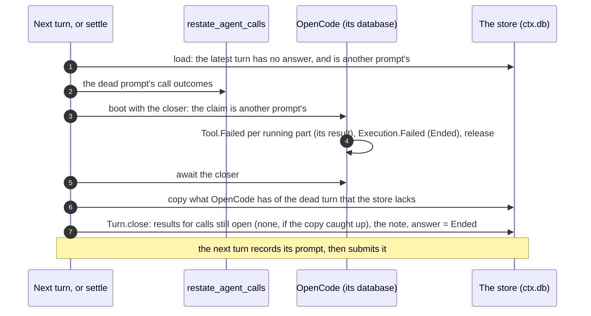

# OpenCode's return: a plan

How OpenCode comes back to `@restatedev/agents`, on the conversation of
turns: what it must do for a turn, what OpenCode does today, the approach,
the alternatives weighed, and the steps. The model is in
[Turn semantics](turns.md) and [The conversation](conversation.md); why
OpenCode left, in [The frameworks](frameworks.md#opencode) (D6 of
[the plan](plan.md#decisions)).

**Status: proposed.** Research of 2026-11-09: OpenCode's published packages
(`@opencode/core`, `sdk`, `server`, `plugin`, `schema`, `util`) at 2.0.32 and
2.2.6, the latest release (2026-11-06), read in their sources, nothing run;
and OpenCode's docs, OpenAPI spec, changelog and issues. Step 0, the
spike, has run since ([The spike's findings](#the-spikes-findings)): a dead
turn is closed without the model, both ways.

## Why it left, and what changed

OpenCode left because a dead turn could not be closed. OpenCode records an
**execution claim** on a session when a turn starts, and every boot of
OpenCode resumes every claimed turn: a synthetic "The server restarted while
you were working. Continue …" message, each running tool part failed
("Tool execution interrupted"), and a new step, in which the model makes its
calls again under new ids. That finishes the dead invocation's turn under the
next invocation's idempotency keys, which the conversation forbids (D8: a
dead turn is closed, never finished). The spike of step 8 booted OpenCode
without its resume and called `session.interrupt`: the call succeeds, and
releases nothing.

What the research found since:

- **No public call ends a claimed turn**, in 2.2.6 either. The OpenAPI
  spec's `POST /api/session/{id}/interrupt` says it: "Interrupt active
  execution owned by this OpenCode process … false for the idle no-op". Its
  handler reads only the process's coordinator, an in-memory map, so a
  claim from a dead process is not there. Users ask for a way off the
  resume, and for a native settle, in
  [#56032](https://github.com/anomalyco/opencode/issues/56032) and
  [#59635](https://github.com/anomalyco/opencode/issues/59635); a preflight
  hook in [#58572](https://github.com/anomalyco/opencode/issues/58572). None
  has a maintainer's answer.
- **OpenCode closes a claimed turn itself, without a model, in one place:**
  when a session's resume budget is spent. `prepareResume`
  (`packages/core/src/session/execution/restart.ts`) counts the resume
  (`resume_attempts`, durably, at each boot) and, past `maxAttempts`,
  publishes `Execution.Failed` ("Execution was interrupted repeatedly and
  will not be resumed automatically.") with the claim's release as its
  commit: an idle marker, the claim released, no synthetic message, no
  drain. Same code in 2.0.32 and 2.2.6, with a test of its own upstream.
- **That budget is the seam the old integration already used**:
  `SessionRestart.node.replace(…)` in `OpenCode.create`'s `overrides`
  (`@opencode/sdk/effect`), there with `maxAttempts: Infinity`. The service
  is replaceable whole: `SessionRestart.node`'s dependencies (`SessionStore`,
  `SessionExecution`, `Bus`, `Job`, `Session`) are all exported from
  `@opencode/core/*`, and `node.mapLayer` keeps them.

So a dead turn _can_ be closed in OpenCode's store: not through its public
client, but through the same override that already decided how OpenCode
resumes. The rest of this page builds on that.

## The spike's findings

Step 0, run on OpenCode 2.2.6 over the object's database, with a scripted
model that fails the test if asked
([`test/opencode-spike.test.ts`](../test/opencode-spike.test.ts),
[`src/opencode/db.ts`](../src/opencode/db.ts); on Node 24, which OpenCode
needs: the test skips on an older Node).

- **A dead turn is closed without the model, both ways**: by a
  `SessionRestart` of our own, and by `SessionRestart.layer({ maxAttempts: 0 })`.
  Each leaves a failed idle marker and releases the claim; a later boot
  resumes nothing; the next prompt is answered in a turn of its own, whose
  model request has the dead call and its result, no "Continue", and does not
  make the call again.
- **A crashed turn of the same prompt is resumed**, as before: the model is
  asked, and the turn finishes.
- **Our result for a cut-off call lands only after a death without
  teardown.** A host that is closed (as an attempt that ends while its
  process lives closes it) fails its running calls itself, with OpenCode's
  "Tool execution interrupted", and keeps the claim: the closer then finds
  no running part. So the closing note must say which calls did happen
  whichever closer runs, and the closer of our own buys little over the
  budget's: **the budget (`maxAttempts: 0`) is the default**, ours stays in
  `db.ts` as an option.
- **A queued prompt does not join the turn; a steered one does.**
  `delivery: 'queue'` starts after the turn's last step, as a new turn of the
  same drain, with no idle marker between. `delivery: 'steer'` joins at the
  next step. Steering uses `'steer'`.
- **Awaiting the sweep is safe, and was not shown to be needed**: in
  process, the sweep ended before the first request in every run.
- **Ported from 0.3.0's `db.ts`**: the workerd replacements are picked by
  the node each replaces (through a private symbol: no public way), not by
  position; `SqlClient.make` takes a `driver`; the workerd profile installs
  no packages, so the tests' model provider is a local file.

## What OpenCode does, in brief

From the sources, 2.0.32 and 2.2.6 alike unless said:

| What                 | Where                                                                                | What it does                                                                                                                                                                                                                                                                                                                                                                       |
| -------------------- | ------------------------------------------------------------------------------------ | ---------------------------------------------------------------------------------------------------------------------------------------------------------------------------------------------------------------------------------------------------------------------------------------------------------------------------------------------------------------------------------- |
| The claim            | `SessionStore.claim`, the commit of `Execution.Started`                              | `UPDATE session_v2 SET time_suspended = now WHERE id = ? AND time_suspended IS NULL`: a turn that starts over a stale claim changes nothing                                                                                                                                                                                                                                        |
| The release          | `SessionStore.release`, the commit of `Execution.Succeeded`, `Failed`, `Interrupted` | `time_suspended = NULL, resume_attempts = 0`; not for an interruption of reason `shutdown` (a host closed mid-turn keeps its claim, on purpose)                                                                                                                                                                                                                                    |
| A turn's end         | the projector's `projectIdle`                                                        | a `session_message` row `{type: 'idle', outcome, error}`, and `session_v2.time_idle`, `idle_outcome`                                                                                                                                                                                                                                                                               |
| One event, one write | `Bus.publish` of a durable event                                                     | one `immediate` transaction: the projections, the commit hook (claim, release), the event's sequence and row                                                                                                                                                                                                                                                                       |
| The resume, at boot  | `SessionRestart.resumeSuspendedSessions`, forked by the host, not awaited            | background jobs first (shell, subagent child sessions; 2.2.6 adds images), then each claimed top-level session not active here: `prepareResume` (above), then `execution.resume`, a forced drain                                                                                                                                                                                   |
| A drain              | `SessionRunner.drain` (`packages/core/src/session/runner/llm.ts`)                    | `settleStaleToolCalls` first, at _every_ drain (a resume's, and the next prompt's): `Tool.Failed` "Tool execution interrupted: <name>" for each streaming or running tool part; then steered input joins the turn (`advanceToStep`; queued input waits for its end), then a step: compaction if due, the `context` hook, the model                                                 |
| Interrupt            | `Session.interrupt` → `SessionExecution.interrupt` → the coordinator                 | ends a drain of this process (`Execution.Interrupted`, released); no drain here, `false`, and nothing is written                                                                                                                                                                                                                                                                   |
| `active`, `wait`     | the coordinator                                                                      | in-memory only: what runs in this process                                                                                                                                                                                                                                                                                                                                          |
| Plugin hooks         | `@opencode/plugin`                                                                   | session `prompt`, `context`, `compaction`, `generate`, `title`, `model.request`, `http.request`, `http.response`, `retry`, `experimental.ws.*`; tool `execute.before`, `execute.after`; `aisdk.sdk`, `language`; `permission.evaluate`; `shell.create.before`; transforms. None runs in the restart, none can veto a turn; 2.2.6 adds `experimental.idle` (a successful idle only) |
| Changed after 2.0.32 | 2.1.0, 2.2.x                                                                         | 2.1.0 renames in the SDK, events and plugin contracts; tool parts move to a `session_part` table; `Execution.Started` sets `time_busy` (2.2.2); `ServerWorkerd.replacements` gains `Npm.node`, so the old `db.ts`'s positional destructuring breaks; `effect` 4.0.1 → 4.1.0                                                                                                        |

## What OpenCode must do for a turn

Each line of the turn model, how OpenCode meets it, and what the old
integration (0.3.0) did. Most of it the old integration did already; the
dead turn is the one hole, and the copy into the store is new.

| The turn model                                                               | How OpenCode meets it                                                                                                                                 | 0.3.0                                         |
| ---------------------------------------------------------------------------- | ----------------------------------------------------------------------------------------------------------------------------------------------------- | --------------------------------------------- |
| **A prompt, once** (`answerOnce`, by its id)                                 | OpenCode's message id is `msg_<prompt id>`; an answered prompt's retry reads its answer from the store and never boots OpenCode                       | by id, but booted every attempt               |
| **Steps stored as they come**, a reply before its tools run                  | OpenCode commits the reply with its tool calls before the tools run; the store gets copies (below)                                                    | the log's transcript, rebuilt at each publish |
| **A tool call publishes as it starts and ends**; a background agent, its end | the `tool.execute.before` and `execute.after` hooks; the end once the copy that holds the result is stored, as pi does                                | the hooks, before the result was stored       |
| **Crashed: the turn goes on**                                                | OpenCode's own resume, for this prompt's claim only; `maxAttempts: Infinity`, so Restate's retry policy decides                                       | yes, for any claim                            |
| **Tool calls, once**                                                         | OpenCode makes a cut-off call again under a new id: Restate's tools rejoin the earlier call by tool and input, as for DeepSeek                        | `retryOf` on the bank's tool                  |
| **Killed: closed, never finished** (D8)                                      | **the hole**: [Closing a dead turn](#closing-a-dead-turn)                                                                                             | finished under the next invocation            |
| **Stopped**                                                                  | `session.interrupt`, while the drain runs here: tools interrupted, an idle marker, the claim released; then `Turn.close` (`CANCELLED`), and the fence | interrupted; no note for the next model       |
| **Refused** (424), **failed for good**                                       | a failed idle marker; a refusal by its error; closed `UNANSWERED` or with the error                                                                   | 424, no note                                  |
| **A provider's outage fails the attempt, not the turn**                      | the `session.retry` hook: retry without limit, or end the attempt; a refusal is never retried                                                         | OpenCode's own retries, then a failed turn    |
| **The closing note reaches the next model**                                  | `(<note>)` starts the next prompt's text, as for pi and DeepSeek                                                                                      | none                                          |
| **Steering**: a message joins at the next step                               | a prompt of `delivery: 'steer'` joins the running turn at its next step, by its id `msg_steer_<id>` (one of `'queue'` waits for the turn's end)       | a message queued waited for the next turn     |
| **Asking again** (`output`'s check) is a step of the turn                    | a second message, `msg_<prompt id>_again`, in the same turn                                                                                           | a second turn                                 |
| **The views read the store**                                                 | `transcribe` and `transcribing` go; `messages` reads the store's copies                                                                               | the log, from OpenCode's messages             |
| **Compaction** is the framework's own                                        | OpenCode's: near the window, on an overflow, or asked; its compaction messages are not copied                                                         | the same                                      |
| **One framework per object** (D7), **a turn carries nothing**                | as for every framework                                                                                                                                | n/a                                           |
| **`clear`** forgets the conversation                                         | the store, then OpenCode's database (`alsoClearing`); not atomic across the two                                                                       | the same                                      |

## The approach: decide at boot whose claim it is

pi's dead runs are closed because pi boots paused: `Harness.open` schedules
nothing until asked, so the integration aborts a dead run first. DeepSeek's
harness closes an interrupted turn at resume, and the integration decides
whether to continue it. OpenCode's restart does both at once, close and
continue, as it boots. The approach separates them by deciding, before
OpenCode boots, which of its claims may go on:

- **The claim is this prompt's** (a retried attempt of the same prompt, or
  its asking again): OpenCode resumes it, as before.
- **The claim is any other prompt's** (a dead invocation's, or an earlier
  prompt of this invocation that failed): OpenCode closes it, and the model
  is not asked.
- **No claim**: nothing to do.

**Whose claim it is comes from `ctx.db`, not from OpenCode's tables.** Before
a prompt is submitted to OpenCode, the integration records it in a table of
its own in the object's database (`restate_agents_opencode`: the last prompt
submitted, one row). The order makes it sound: a claim is made only by a
prompt recorded first, and a boot that closes a claim finishes (the sweep is
awaited) before the next prompt is recorded. So at boot, a claim, if any, is
the recorded prompt's: this prompt's, or another's. The integration never
reads OpenCode's tables, whose layout changed between 2.0.32 and 2.2.6
(`session_part`).

**The closer is a `SessionRestart` of the integration's own**, given in
`overrides` as the old `maxAttempts: Infinity` was. For each claimed
top-level session not active in the process, if the claim may go on, it does
what OpenCode's restart does (built inside, with `maxAttempts: Infinity`);
otherwise it closes it, with the same events OpenCode's budget uses:

1. a `Tool.Failed` for each streaming or running tool part, with the result
   the conversation gives that call (`cutOffResult` of the call's outcome in
   `restate_agent_calls`: the error its Restate call returned,
   `RETURNED_UNRECORDED` if it returned, or else the note that ends the
   turn). OpenCode's model history then says what the store says;
2. `Execution.Failed` with the `ENDED` note as its error, and
   `{ commit: () => store.release(id) }`: the idle marker and the release,
   in one transaction;
3. background jobs and child sessions as OpenCode's restart handles them
   (v1 has none: [Background work](#background-work-and-permissions)).

It resolves a promise once done: the host forks the sweep, so a prompt
submitted before it ends could join the dead turn. The old integration
polled for that (`STALLED_MS`); the closer is awaited instead.

**The fallback, if the custom service proves too internal:**
`SessionRestart.layer({ maxAttempts: 0 })` when the recorded claim is
another prompt's, `Infinity` when it is this prompt's: OpenCode's own code,
and only an option of it. It writes the idle marker and releases the claim;
the running tool parts stay running until the next prompt's drain fails them
with OpenCode's "Tool execution interrupted", so OpenCode's history loses
which calls did happen. The closing note makes up for it: the `ENDED` note,
and the calls that returned (`(Ended: … These calls did happen: …)`). The
fallback's error text is OpenCode's own, which the integration must not
take for a turn's failure.

## Closing a dead turn

A dead turn is closed in two stores, OpenCode's and the conversation's, which
share no transaction. The order keeps them consistent through a crash
anywhere: OpenCode first, then the copy, then the store.

- **A crash before OpenCode's close** leaves both open: the next attempt does
  it all again.
- **A crash after it** leaves OpenCode closed and the store open: the next
  attempt boots with no claim, copies, and closes the store.
- **A crash after the copy** is the same; the copy is idempotent (by
  OpenCode's message and part ids).

The core needs one change for it: **a framework's hook before a dead turn is
closed.** Today `answerTurn` closes a turn left open before the run starts,
and `settle` (`object.ts`) closes it knowing nothing of the framework. With
framework-owned history whose copy may lag (OpenCode's alone), the
framework must close its own store, and copy, first. Proposed:
`answerOnce`'s options take `settleOwn(turn)`, called before
`running.close(…)`; and the `messages` view carries the same hook beside its
`Items` (as `ITEMS` does), for `settle`. pi and DeepSeek give none: their
copy is in their own transaction, and pi aborts its dead run as `withPi`
opens.

`settle` then boots OpenCode (about 100 ms, 2 s for a process's first
import) for a turn that the companion found dead, so that a follower reads
the turn ended before the next message, as for every framework.

## The copy into the store

OpenCode's database is its own (it boots only on an empty one, or its own),
beside `ctx.db` (`database(ctx.db, 'restate-agents.opencode')`): a second
SQL session, so a copy cannot be in OpenCode's transaction as pi's is.

- **Items**: an OpenCode message. `read`: a user message is said; a
  synthetic one, an idle marker and a compaction say nothing (they are not
  copied); an assistant message says its text, its tool parts are calls, and
  those completed or failed are results too, from the same item.
  `results(calls)`: an assistant-shaped item with failed tool parts (OpenCode
  has no tool result message). `reply(text)`: an assistant message, for the
  store only.
- **When**: after OpenCode commits a transaction that changed the turn's
  messages (the SQL client sees each commit, as pi's storage facade does),
  and before each publish, before the turn's answer, and before any close.
  An assistant message is copied once its step ended (OpenCode updates it in
  place as it streams); a tool part's result once completed or failed.
- **Idempotent**: keyed by OpenCode's message and part ids, so a crash between
  OpenCode's commit and the copy loses nothing: the next copy catches up.
  What lags is what a follower sees, never what the model gets.
- **Not copied**: the prompt (the turn's row is the prompt), OpenCode's
  synthetic messages (the restart's "Continue", as DeepSeek's `CONTINUE` is
  not), idle markers, compaction summaries, and anything between turns.

## Background work and permissions

With a workspace, OpenCode keeps its own tools, and some of them outlive a
tool call: subagents (child sessions, background ones too), background shell
jobs, questions to the user, permission asks. 0.3.0 left them in, and the
asks and questions waited on in-memory promises that nothing answered.

- **v1 removes** the subagent (`task`) and question tools, and background
  shell jobs, through the tools plugin (`editor.remove`). Restate's own
  `subagent` tool is the way to delegate: its calls are made once.
- **Permissions**: OpenCode's config allows what the workspace may do; or,
  opt-in, `permission.evaluate` waits for an approval through Restate
  (`waitFor(ctx, callId, signal, input, { approval: true })`), so an ask
  survives crashes and is answered by a signal, as every other approval.
- Child sessions and background jobs come later, once their recovery is mapped
  onto turns (a child session is a claim of its own, which the restart
  releases with its parent's).

## Alternatives weighed

| Approach                                                                | Verdict                                                                                                                                                                                                                   |
| ----------------------------------------------------------------------- | ------------------------------------------------------------------------------------------------------------------------------------------------------------------------------------------------------------------------- |
| **A closer `SessionRestart`**, through `overrides`                      | **Chosen.** Exported module paths and typed services, the events OpenCode's own budget publishes; the integration controls each tool part's result. Internal API: pinned exactly, and a test per seam fails on an upgrade |
| `SessionRestart.layer({ maxAttempts: 0 })` for another prompt's claim   | **The fallback.** Only an option of OpenCode's; loses which calls happened from OpenCode's history (the note says it); error text not ours                                                                                |
| A plugin `context` hook that throws on the restart notice               | A backup, should `overrides` go: public API, but it runs after the synthetic "Continue" and stale tools settled, compaction or a title may call a model first, and a throwing hook's outcome is undocumented              |
| Fork at the last answered message, then remove the dead session         | Public calls only, but not atomic, a new session id per dead turn, and the event log restarts; until the remove, the next boot resumes the dead session                                                                   |
| Export, edit, import under the same id (`/experimental/session/import`) | Would let OpenCode take the turn projection (D4's other way), but import is experimental, writes rows past the event log, and drops OpenCode's compaction                                                                 |
| SQL on OpenCode's tables (the integration owns the database)            | No: the tables are projections of an event log, which would drift, and their layout changed in 2.2 (`session_part`)                                                                                                       |
| `opencode serve` or ACP, which never run the sweep                      | No: claims stranded, no idle marker, and upstream treats it as a bug ([#56313](https://github.com/anomalyco/opencode/issues/56313))                                                                                       |
| Wait for an upstream settle                                             | Propose it ([Upstream](#upstream)), don't wait for it                                                                                                                                                                     |

## Upstream

What would make the closer unnecessary, worth proposing on
[#56032](https://github.com/anomalyco/opencode/issues/56032) (a switch off
the resume; [#59635](https://github.com/anomalyco/opencode/issues/59635),
where a comment asks for a native settle, is pending close as its
duplicate). To be posted by a maintainer of this package, not by an agent:

- `session.settle(id, { tools?: Record<partID, result>, error })`: close a
  claimed turn that no process runs, without a model: each running part's
  result, a terminal event, the release.
- Or a per-boot choice: `resumeSuspendedSessions({ filter })`, which sessions
  to resume and which to settle.

Either replaces the closer in `db.ts`; the rest of this plan stands.

## Steps

Each step is a commit or a few, and leaves `pnpm lint` and `pnpm test`
passing. The old sources and tests are in git (`84cefaf^`:
`packages/agents/src/opencode/`, `test/opencode*.ts`,
`test/fakes/opencode*.ts`, `test/storage/opencode.test.ts`,
`examples/basic/opencode.ts`).

### Step 0: the spike

Run what this page only read, on OpenCode 2.2.6 over the object's database
(`db.ts` ported), with the scripted model of the old tests:

1. a turn killed in a tool call; the next boot with the closer: no model
   request (the scripted model fails the test if asked), each running part
   failed with the given result, an idle marker with the note, the claim
   released, and the next prompt answered in a turn of its own;
2. a crash of the same prompt: the boot resumes it, as before;
3. the closer awaited: a prompt submitted right after boot never joins the
   dead turn;
4. the fallback, `maxAttempts: 0`, the same way;
5. the inbox: a prompt queued while a drain runs joins it at its next step.

**Done** ([The spike's findings](#the-spikes-findings)): the budget is the
default closer, and steering is `delivery: 'steer'`.

### Step 1: back, at 2.2.6, as it was

`src/opencode/` and its subpaths (`./opencode`, `./opencode/db`) restored and
ported to 2.2.6 and `effect` 4.1.0 (2.1.0's renames; `replacements` taken by
tag, not by position); the devDependencies and optional peers as for the
other frameworks; the fakes. Not on the store yet.

**Done when** the old tests compile and pass but for the dead turn's.

### Step 2: on the store

`Items` of OpenCode's messages, `answerOnce` with `ownHistory`, the copy,
lazy boot (an answered prompt's retry boots nothing), the views from the
store; `transcribe` and `transcribing` go.

**Done when** the store's tests that pi and DeepSeek pass (the copy across
crashes, the views, `clear`) pass for OpenCode.

### Step 3: dead turns

The record of the submitted prompt, the closer (or the fallback), the
`settleOwn` hook in `conversation.ts` and `object.ts`, `settle` booting
OpenCode.

**Done when** a dead turn is closed, never finished, by the next message and
by `settle`: the bank's transfer is made once, with a tool that ignores
`retryOf`; and a kill at any of the attempt's state requests leaves both
stores consistent.

### Step 4: the rest of the turn

Stop (interrupt, then `Turn.close`, then the fence), refusal and failure,
the `retry` hook, the closing note in the next prompt, steering through the
inbox, asking again, `output`, background agents' publishes, v1's tools
removed and permissions.

**Done when** each line of [the table](#what-opencode-must-do-for-a-turn)
has its test.

### Step 5: crashes, end to end

`OpenCodeAgent` back in `packages/e2e/crash.ts`, kills included;
`pnpm --filter e2e packaging` with OpenCode's packages.

**Done when** `pnpm --filter e2e crash` passes: every message moves money
exactly once.

### Step 6: docs and examples

[The frameworks](frameworks.md#opencode) rewritten from this page; the
README's frameworks table and its OpenCode section; D6 marked done;
`examples/basic/opencode.ts`; the foreman's worker, senior and reviewer on
OpenCode (`examples/advanced/foreman`).

**Done when** the docs say what the code does, and the examples run.

## Risks

- **Internal API.** The closer uses `@opencode/core`'s `SessionRestart`,
  `SessionStore`, `Bus` and `SessionEvent`: exported, typed, undocumented.
  OpenCode is pinned exactly, and step 0's tests run on every upgrade; the
  fallback needs only `SessionRestart.layer`'s option.
- **Two stores, no shared transaction**: the copy lags a crash (followers,
  never the model); `clear` is not atomic; three copies of each conversation
  (OpenCode's events, its messages, the store's items).
- **Messages updated in place** against items appended once: an assistant
  message is copied once its step ended, so a follower sees a step at once,
  not as it streams.
- **The event log grows** without bound, as pi's tables do.
- **Cost**: a boot per attempt (about 100 ms; 2 s for a process's first
  import), and some hundreds of SQL statements a prompt; Node 24.
- **Upstream may change the resume** (a config key off, a settle, a bounded
  resume): each would simplify the closer, none should break the record of
  the submitted prompt.

## Decisions proposed

| #   | Decision                                                                                                       | Why                                                                                      |
| --- | -------------------------------------------------------------------------------------------------------------- | ---------------------------------------------------------------------------------------- |
| O1  | **OpenCode 2.2.6**, `effect` 4.1.0, pinned exactly                                                             | 2.0.32 predates 2.1.0's renames; the closer's seams are the same in both                 |
| O2  | **Whose claim it is comes from `ctx.db`**: the last prompt submitted, recorded before its submit               | OpenCode's tables are projections whose layout changes; the order makes the record sound |
| O3  | **A dead turn is closed by OpenCode's resume budget** (`maxAttempts: 0`), the note saying which calls happened | No public call does it; the spike showed a closer of our own buys little over it         |
| O4  | **OpenCode first, then the copy, then the store**, through a `settleOwn` hook of `answerOnce` and `settle`     | The only order that stays consistent across a crash between two stores                   |
| O5  | **The copy is idempotent and catches up** before each publish, answer and close                                | It cannot share OpenCode's transaction                                                   |
| O6  | **v1 without OpenCode's background work** (subagents, background shells, questions)                            | Their recovery is not yet mapped onto turns; Restate's `subagent` delegates instead      |
